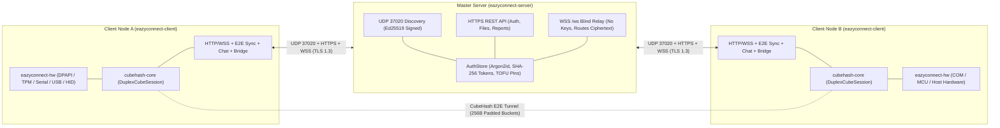

# EazyConnect Architecture

EazyConnect v0.2.0 splits transport, OS/hardware interfacing, cryptography, server hosting, and client automation into five focused crates.

## System Topology

## Crate Breakdown

### 1. `crates/cubehash-core`
- Compiled with `#![forbid(unsafe_code)]`.
- Implements the 3-cube custody hierarchy (`MotherCube`, `MainCube`, `AuditorCube`) feeding a stateful `CellularMesh` and paired `DuplexCubeSession`.
- Provides three sizing profiles accessible via `EazyMeshProfile`:
  - `Standard` (`MeshConfig::standard()`): `100` cubes (`125`B sub-matrix / `32`B core), `25` selected / `20` consumed per transaction, `1000^3` spiral space.
  - `Compact` (`MeshConfig::compact()`): `40` cubes (`64`B sub-matrix / `16`B core), `12` selected / `9` consumed, `256^3` spiral space.
  - `HighCapacity` (`MeshConfig::high_capacity()`): `160` cubes (`256`B sub-matrix / `64`B core), `40` selected / `32` consumed, `2000^3` spiral space.
- Protects each peer packet with `DeliveryAck`-gated TX state transitions (plus rollback on offline peer or drop), `X25519` epoch ratcheting, Triple Modular Redundancy bit-rot repair, and constant-work `decrypt_zero_oracle` DTE deception.

### 2. `crates/eazyconnect-hw`
- `keystore`: OS-sealed `DeviceIdentity` (`*.eazyconnect-id.json`), `seal_local_secret` / `unseal_local_secret`, TOFU peer public-key pins, TPM 2.0 CNG detection, and `MachineGuid` lookup binding into `OsBoundHardwareProvider`.
- `peripherals`: USB enumeration via `nusb`, Windows HID enumeration via `SetupDiGetClassDevsW` + `HidD_*`, COM/Serial enumeration via `serialport`, `SerialTransport` trait (`OsSerialTransport` + `MemorySerialTransport`).
- `system`: Host interface/VPN adapter inventory via Win32 `GetAdaptersAddresses` (including IPv4 CIDR prefixes `ipv4_cidrs`, `classify_vpn_adapter`, `collect_lan_directed_broadcasts`, and `best_lan_ipv4`), admin elevation check (`IsUserAnAdmin`), and aggregated `SystemHardwareReport`.

### 3. `crates/eazyconnect-core`
- `tls`: `ServerTlsConfig` (`SelfSigned`, `LoadOrCreateSelfSigned`, `PemFiles`, `InsecureDisabled`), `ClientTlsConfig` (`WebPkiRoots`, `CaPem`, `PinnedCertSha256`), URL parser `parse_endpoint_url`, and shared TCP keepalive (`configure_tcp_keepalive` / `connect_tcp_keepalive` via `socket2`).
- `discovery`: Signed UDP `37020` LAN & unicast discovery (`DISCOVER_EAZYCONNECT`) sending per-NIC LAN directed broadcasts past full-tunnel Exit VPNs, selecting peer-matched endpoints (`select_beacon_endpoints`), and signing `alternate_urls` with `Ed25519` (`eazyconnect-discover-v3`).
- `protocol`: `RelayFrame` signaling/routing messages, 256-byte bucket-padded `EazyAppMessage` (`ChatText`, `FileShared`, `SerialData`, `SerialCommand`, `HardwareProbeRequest`, `HardwareProbeResponse`), canonical `Ed25519` signing transcripts, and `provision_duplex_from_ecdh`.
- `envelope`: Client-side E2E vault envelopes (`EZV1`) and incremental `BLAKE3` folder delta scanning (`SyncManifest`, `scan_folder_delta`).
- `config`: Persistent `ClientConfig` with DPAPI-sealed bearer token storage and bilingual (`en` / `fa`) `UserProfile`.

### 4. `crates/eazyconnect-server`
- Serves HTTPS REST API and WSS `/ws` on the same port via `hyper` + `axum` + `tokio-rustls` with `TCP_NODELAY` and `SO_KEEPALIVE`.
- Persists self-signed TLS certificates in `<data-dir>/tls/` across restarts (`LoadOrCreateSelfSigned`, optional `--regen-tls`) with multi-homed LAN + VPN SANs and optional `--lan-only` binding.
- Runs an optional background UDP `37020` discovery responder and enforces 20s/65s WebSocket heartbeats plus verified `Ed25519` session reclaim on `/ws`.
- `AuthStore` shares enrolled device Ed25519 TOFU pins across both HTTP challenge-verify enrollment and WebSocket `RegisterAuth` handshakes.

### 5. `crates/eazyconnect-client`
- `MasterHttpClient` over `tokio-rustls` + `hyper` with enforced HTTPS/pin verification, TCP keepalive, 15s connect timeout, and scaled slow-link transfer timeouts.
- `EazyNode` managing non-blocking WSS transport with 20s heartbeats, stateful `auto_reconnect` (rolling back un-ACKed `inflight` TX packets cleanly), per-peer outbound `DeliveryAck` queuing, `X25519` pairing, E2E chat, and encrypted hardware serial bridge dispatch.
- Shared `session` vault/TLS resolution helpers, `sync` folder delta uploader, `diag` host/network/LAN collector, and CLI binary `eazyconnect-client` (including `ui` launcher).

### 6. `crates/eazyconnect-ui` & `installer/`
- Native Discord-style desktop chat application `eazyconnect-ui.exe` powered by `eframe`/`egui` and `rfd`, automating UDP discovery, TLS pin acquisition, device enrollment, WSS auto-reconnect, and background CubeHash pairing behind a clean Chat / Profile / Settings (`Account`, `Theme`, `Connection`) experience.
- Graphical Windows WPF Setup & Prerequisite Wizard (`installer/EazyConnect-Setup.ps1` + `Setup-EazyConnect.bat`) + Inno Setup 6 build script (`installer/build-installer.ps1`).

## Master Server API Endpoints

| Method & Route | Auth | Purpose |
| --- | --- | --- |
| `GET /api/v1/health` | Public | Server status, version, `master_ed25519_pub_hex`, `tls_cert_sha256_hex`, counts |
| `GET /api/v1/auth/challenge` | Public | Issues 60s single-use 32-byte challenge nonce + `challenge_id` |
| `POST /api/v1/auth/verify` | Challenge Sig | Verifies `Ed25519` signature, checks invite code / TOFU pin, issues bearer token |
| `POST /api/v1/auth/login` | Password | Verifies `Argon2id` password hash and issues 24h bearer token |
| `POST /api/v1/users` | Admin Bearer | Creates user (`username`, `password >= 8`, `is_admin`) |
| `GET /api/v1/devices` | Bearer | Lists enrolled devices and pinned `Ed25519` keys |
| `POST /api/v1/files/upload` | Bearer | Stores file (`?path=<rel>&e2e=<bool>`, max 128 MiB) + `BLAKE3` metadata |
| `GET /api/v1/files/list` | Bearer | Lists owner files (admin may query `?owner=`) with `BLAKE3` hashes & `e2e` flags |
| `GET /api/v1/files/download/{owner}/{*path}` | Bearer | Downloads file with `x-eazy-blake3` & `x-eazy-e2e` headers |
| `DELETE /api/v1/files/{*path}` | Bearer | Deletes caller-owned file and metadata sidecar |
| `POST /api/v1/report` | Bearer | Saves client JSON diagnostic hardware report |
| `GET /api/v1/relay/telemetry` | Bearer | Returns blind relay frame metadata (no plaintext, capped history) |
| `GET /ws` | WS `Ed25519` Auth | Blind WebSocket relay routing `PairOffer`, `PairAccept`, `EncryptedPacket`, `AckFrame`, `EpochHopNotice` |
